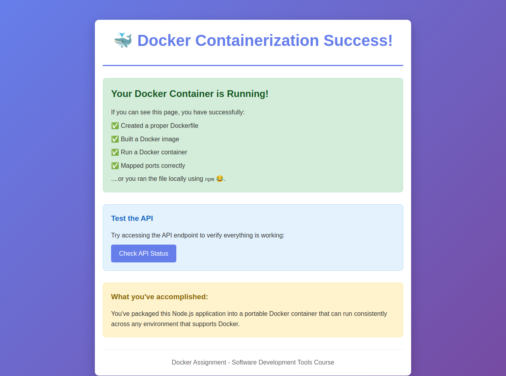
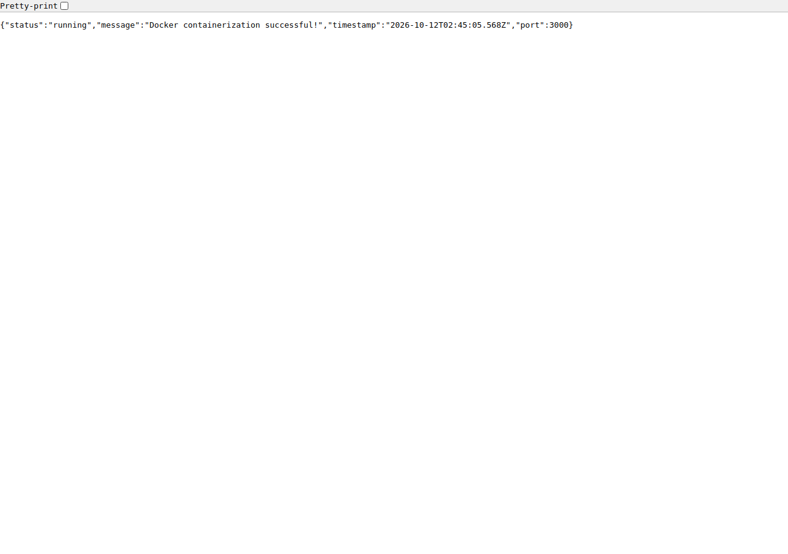

# Assignment #4: Application Containerization

This project containerizes the provided Node.js Express application. The original application code is unchanged.

## Application Overview

- `/`: application success page
- `/api/status`: JSON status response
- `/health`: health check
- Default server port: 3000

## Starting the Application

Install and start Docker Desktop, then clone this repository and enter its directory:

```bash
git clone https://github.com/Bigdbetd/docker-containerization-assignment4.git
cd docker-containerization-assignment4
```

Build the image from the Dockerfile in the current directory. The `-t` option names the image:

```bash
docker build -t docker-assignment4 .
```

Start a named container in detached mode (`-d`) and map host port 3000 to container port 3000 (`-p`):

```bash
docker run -d -p 3000:3000 --name docker-assignment4-app docker-assignment4
```

Open http://localhost:3000 and http://localhost:3000/api/status in your browser. Node.js does not need to be installed on the host because it is included in the image.

## Practice Container Management

```bash
# List running containers.
docker ps
# Stop the application container.
docker stop docker-assignment4-app
# Restart the same container.
docker start docker-assignment4-app
# View server output if troubleshooting is needed.
docker logs docker-assignment4-app
# Stop the container before removing it.
docker stop docker-assignment4-app
# Remove the stopped assignment container; the image remains available.
docker rm docker-assignment4-app
```

## Screenshots

The verification workflow builds and runs the Docker image on a GitHub-hosted Linux runner, checks both endpoints, and captures actual browser screenshots at the runner's localhost:3000. These are automated captures, not screenshots from a personal computer. It also practices stopping, restarting, and removing the test container.

### Application at localhost:3000



### API at localhost:3000/api/status



## Reflection Question

How does containerization with Docker differ from using virtual machines, and why might a development team choose Docker containers over VMs for deploying applications like this one?

A virtual machine runs a complete guest operating system on virtual hardware. A Docker container packages the application, its runtime, and its dependencies while sharing the kernel of the system running Docker. On Windows or macOS, Docker Desktop typically uses a Linux virtual machine to run Linux containers. Containers usually start faster and use less memory and storage than separate virtual machines because each container does not need its own full operating system.

A development team might choose Docker for this Node.js application because everyone can run the same image with the same Node.js version and dependencies. This helps prevent the problem where code works on one developer's computer but fails on another. The image can also be tested in an automated pipeline and deployed consistently, and teams can start more containers when they need additional application instances. Virtual machines may be a better choice when a full separate operating system or stronger isolation is needed.

## Dockerfile

Every instruction is commented. It uses `node:16`, sets `/app` as the working directory, copies the package manifests, runs `npm install`, copies the application files, exposes port 3000, and starts the server with `npm start`. Node 16 is used to match the assignment example; a maintained Node version should be used for a production deployment.
